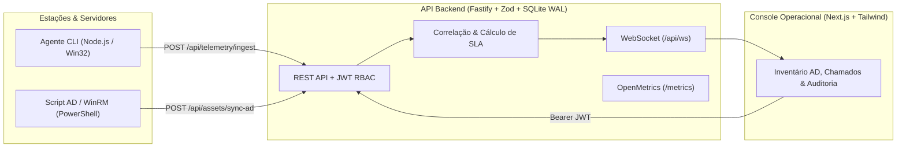

# InfraDesk

Plataforma full-stack em TypeScript para **inventário de computadores integrado ao Active Directory (CMDB)**, **coleta de telemetria e ociosidade de estações** (evolução do projeto *Idlewatch*) e **atendimento de chamados com controle de SLA e auditoria**.

O console web opera conectado à API REST + WebSocket (`Fastify` + `SQLite`) ou em modo de demonstração local estático para publicação direta no **GitHub Pages**.

---

## Arquitetura



| Diretório | Escopo | Stack |
| :--- | :--- | :--- |
| [`backend/`](./backend) | API REST, WebSockets, autenticação JWT (`HS256` + `scrypt`), RBAC, cálculo de SLA, abertura automática de incidentes e `/metrics` | Node.js 24+, Fastify 5, `node:sqlite`, Zod |
| [`agent/`](./agent) | Coletor multiplataforma (`--once` ou contínuo) + script PowerShell para varredura de Unidades Organizacionais (`Get-ADComputer` + CIM/WinRM) | TypeScript, `node:os`, PowerShell, `GetLastInputInfo` |
| [`frontend/`](./frontend) | Console operacional com tema claro/escuro neutro, números tabulares, inspeção lateral de ativos/chamados e exportação CSV | Next.js 15, React 19, Tailwind CSS v4 |

---

## Funcionalidades principais

- **Controle de acesso (RBAC):** perfis `admin` (leitura, escrita e exclusão), `technician` (operação de inventário, telemetria e atendimento) e `viewer` (auditoria somente-leitura, bloqueado com `HTTP 403` em rotas mutáveis).
- **Inventário Active Directory & Ociosidade:** organização por *Distinguished Name* (`OU=...`), patrimônio, hardware, processos de maior consumo e tempo de inatividade da sessão do usuário.
- **Correlação automática de incidentes:** leituras de telemetria acima do limiar crítico (`CPU >= 92%`, `RAM >= 94%` ou `Disco >= 92%`) marcam o host em alerta e abrem automaticamente um chamado `P1` vinculado ao equipamento caso não haja incidente aberto.
- **Gestão de SLA:** cálculo de vencimento por prioridade (`2h`, `8h`, `24h`, `48h`) com acompanhamento de chamados no prazo, em risco (restante ≤ 25% da janela) e violados, em visualização de lista ou colunas.
- **Auditoria e métricas:** histórico cronológico em `audit_logs` e exportação no padrão Prometheus em `GET /metrics`.

---

## Execução local

### Com Docker Compose

```bash
docker compose up --build -d
```

- Console Web: `http://localhost:3000`
- API / Healthcheck: `http://localhost:3333/api/health`
- Métricas Prometheus: `http://localhost:3333/metrics`

### Ambiente de desenvolvimento (Node.js 24+)

```bash
# Instalar dependências
npm run install:all

# Subir API (porta 3333)
npm run dev:backend

# Subir interface web (porta 3000)
npm run dev:frontend

# Coletar telemetria real da estação local e enviar à API
npm run agent:once
```

### Credenciais iniciais (seed automático)

| Papel | E-mail | Senha |
| :--- | :--- | :--- |
| `admin` | `admin@infradesk.dev` | `Admin@2026` |
| `technician` | `tech@infradesk.dev` | `Tech@2026` |
| `viewer` | `auditor@infradesk.dev` | `Audit@2026` |

---

## Testes e build

```bash
npm test
npm run build
```

---

## Deploy no GitHub Pages

O workflow [`.github/workflows/pages.yml`](./.github/workflows/pages.yml) gera a exportação estática com `basePath` dinâmico a partir do nome do repositório. Em `Settings → Pages → Build and deployment → Source`, selecione **GitHub Actions**.

---

## Licença

Distribuído sob a licença [MIT](./LICENSE). Desenvolvido por [Rafael Merlo Mendes](https://github.com/rafaelmm16).
